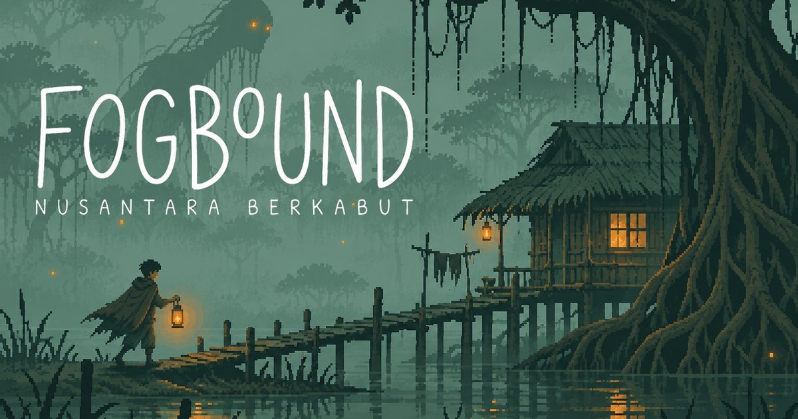

# Fogbound — Nusantara Berkabut

Game side-scroller pixel art berkabut ala Limbo. Adam membawa sebuah lentera, melewati desa yang tenggelam, lembah rawa, hutan belantara, dan lereng istana, sampai ke takhta Raja Kabut.

**Main langsung:** https://ambrdix-gif.github.io/fogbound/

- 5 bab, dibuka satu per satu (selesaikan bab sebelumnya dulu). Progres disimpan di browser (localStorage).
- Keyboard: A/D atau panah untuk jalan, Spasi untuk lompat, E untuk api lentera / masuk / baca kitab, R untuk ulang dari lampu, M untuk suara.
- HP: otomatis landscape. Joystick di kanan (geser = jalan, dorong atas = lompat, tarik bawah = turun), tombol E di kiri untuk api.

Satu file `index.html`, tanpa library dan tanpa file eksternal: semua gambar, font, dan suara sudah ada di dalamnya.

Sumber lengkap ada di folder [`src/`](src/) (lihat `src/README.md` untuk cara build). Game ini mencatat statistik main secara anonim lewat GoatCounter (tanpa cookie, tanpa data pribadi).
